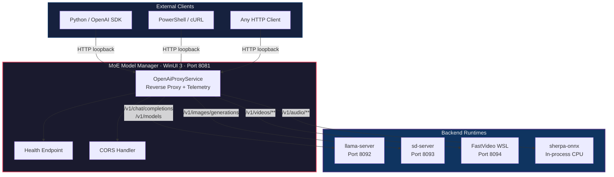
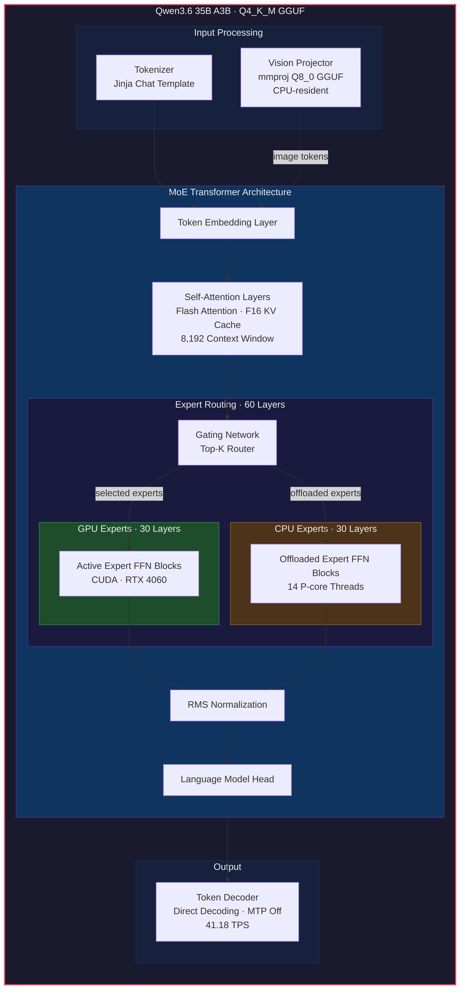
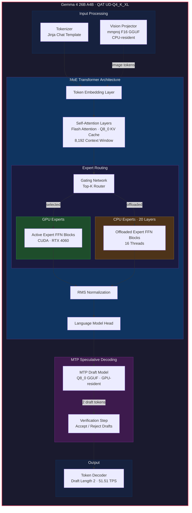
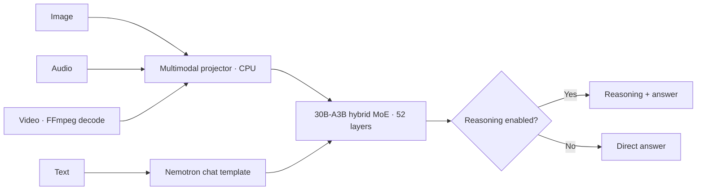
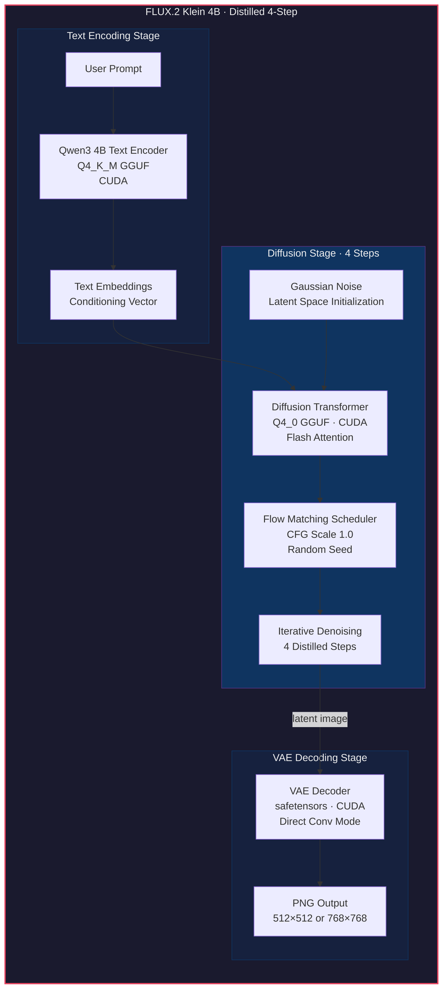
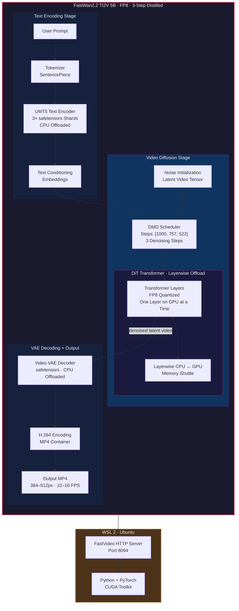
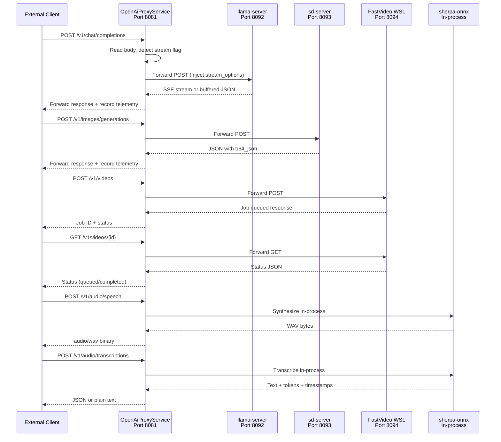
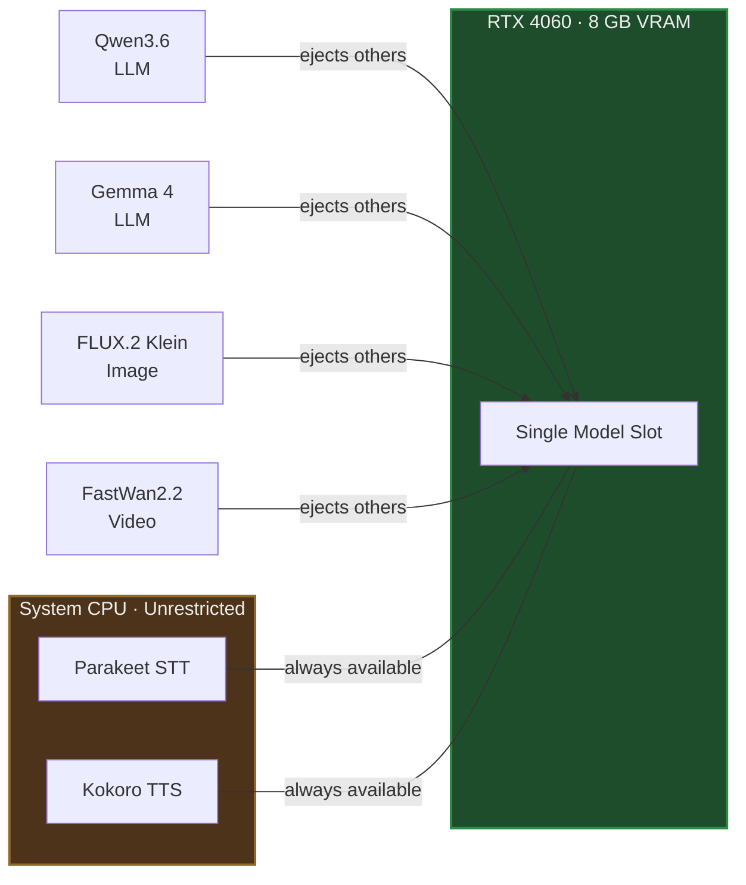

# MoE Model Manager

Native WinUI 3 desktop control center for local Nemotron 3 Nano Omni, Qwen3.6, Gemma 4, FLUX.2 Klein, FastWan2.2, NVIDIA Parakeet, and Kokoro models. It provides multimodal Markdown chat, image/video generation, speech transcription, text-to-speech playback, and an OpenAI-compatible API.

## What is included

- Model selection, load, eject, and live runtime status.
- Streaming local chat with native Markdown rendering and image, audio, or video attachments. Nemotron Omni can switch reasoning on or off per request, and **New chat** clears prior context without ejecting the model.
- FLUX.2 Klein image generation with size selection, in-app preview, automatic local saving, and cancel support.
- FastWan2.2 three-step video generation with Turbo, Balanced, and Quality presets, in-app MP4 playback, local saving, and stop/eject support.
- Native C# speech-to-text with Parakeet TDT 0.6B v3 INT8 and text-to-speech with Kokoro 82M, including editable transcription, voice/speed selection, WAV playback, and local saving.
- OpenAI-compatible `GET`/`POST`/`DELETE` proxy at `http://127.0.0.1:8081/v1`.
- Request activity showing chat TPS, image duration, or completed video generation duration for desktop and external API calls.
- Pinned CUDA 12.4 llama.cpp runtime installer (`b10359`) with Nemotron Omni image, audio, and video input support.
- Pinned CUDA 12 stable-diffusion.cpp image runtime (`e31a86c`).
- Pinned FastVideo WSL runtime (`1b2b2a0`) with FP8 transformer quantization and layerwise offload.
- In-process sherpa-onnx audio runtime; Python and a separate audio server are not required.
- Reproducible x64 MSIX packaging script.

The GGUF and safetensors files are intentionally not stored in this repository. The app and runtimes live in the repository, while large model files stay under `E:\Models`.

---

## Environment Setup & Reproduction Guide

Follow these steps to set up a fresh clone into a fully operational local AI control center.

### Prerequisites

| Requirement | Specification |
| --- | --- |
| **Operating System** | Windows 11 x64 |
| **GPU** | NVIDIA RTX GPU with CUDA driver installed (8 GB VRAM minimum, RTX 4060 verified) |
| **System RAM** | 32 GB minimum (64 GB host RAM recommended for sustained FastWan video generation) |
| **SDK & Workload** | [.NET 10 SDK](https://dotnet.microsoft.com/download/dotnet/10.0) + Windows application development workload |
| **Build Tools** | [Git](https://git-scm.com/), [CMake](https://cmake.org/), NVIDIA CUDA Toolkit (12.x and 13.x) |
| **WSL Support** | WSL 2 with Ubuntu (required for FastVideo video runtime) |
| **Python Tooling** | `uv` and Hugging Face CLI (`uv tool install huggingface-hub`) |

---

### Step-by-Step Setup

#### 1. Clone the repository

```powershell
git clone https://github.com/nakultt/MoE.git
Set-Location MoE
```

#### 2. Verify & Configure WSL 2 Environment (for FastVideo Video Generation)

FastVideo runs inside WSL 2 (Ubuntu) and requires sufficient RAM allocation (`28GB` recommended) and matching username configuration:

```powershell
# Run WSL diagnostic, auto-configure %USERPROFILE%\.wslconfig memory limits, and sync video-model.json to your WSL username
.\scripts\verify-wsl-environment.ps1 -ConfigureWslConfig

# If .wslconfig was created or updated, restart WSL for changes to take effect:
wsl --shutdown
```

#### 3. Install local inference runtimes

Run the runtime installation scripts to download and compile native backends:

```powershell
# Install llama.cpp release b10359 with CUDA 12.4 into runtime\llama.cpp-b10359-cuda12.4
.\scripts\install-runtime.ps1

# Clone and compile stable-diffusion.cpp (e31a86c) with CUDA 12 into runtime\stable-diffusion.cpp
.\scripts\install-image-runtime.ps1
```

#### 4. Download model weights

Run the automated Hugging Face setup scripts to download model weights into `E:\Models` or another model directory:

```powershell
# Download Qwen3.6 35B A3B & Gemma 4 26B A4B GGUFs, vision projectors, and MTP draft models (~36 GB)
.\scripts\setup-llm-models.ps1 -ModelRoot 'E:\Models'

# Download the low-memory GGUF and build the combined NVIDIA vision+audio projector (~22 GB total download)
.\scripts\setup-nemotron-omni.ps1

# Download FLUX.2 Klein 4B GGUF, Qwen3-4B text encoder, and VAE safetensors (~7.2 GB)
.\scripts\install-image-model.ps1 -ModelDirectory 'E:\Models\flux2-klein'

# Setup FastVideo WSL environment, apply 8 GB VRAM patch, and download FastWan2.2 5B video model (~24 GB)
.\scripts\setup-video-runtime.ps1 -ModelDirectory 'E:\Models\fastwan2.2-5b'

# Download Parakeet TDT 0.6B v3 STT & Kokoro 82M TTS ONNX model archives (~800 MB)
.\scripts\setup-audio-models.ps1 -ModelRoot 'E:\Models'
```

#### 5. Configure local model paths

If your models are stored outside the default directory, update the paths in the JSON configuration files under `src\MoE.ModelManager\Configuration\`:

- **Text models:** [models.json](src/MoE.ModelManager/Configuration/models.json) (`modelPath`, `visionProjectorPath`, `draftModelPath`)
- **Image model:** [image-model.json](src/MoE.ModelManager/Configuration/image-model.json) (`diffusionModelPath`, `textEncoderPath`, `vaePath`)
- **Video model:** [video-model.json](src/MoE.ModelManager/Configuration/video-model.json) (`modelPath`)
- **Audio models:** [audio-model.json](src/MoE.ModelManager/Configuration/audio-model.json) (`parakeetModelPath`, `kokoroModelPath`)

Also verify path settings in `settings.ps1` if using fallback llama.cpp Web UI launcher scripts.

#### 6. Build and run the desktop application

```powershell
# Build and run Debug build
dotnet build .\src\MoE.ModelManager\MoE.ModelManager.csproj -c Debug -p:Platform=x64
dotnet run --project .\src\MoE.ModelManager\MoE.ModelManager.csproj -c Debug -p:Platform=x64
```

#### 7. Run test suite

```powershell
dotnet test .\src\MoE.ModelManager.Tests\MoE.ModelManager.Tests.csproj -c Debug -p:Platform=x64
```

#### 8. Build MSIX installer (optional)


```powershell
# Generate self-signed certificate and build x64 MSIX package
.\scripts\build-installer.ps1

# Install locally via App Installer
.\scripts\install-app.ps1
```

Commits pushed to `main` that change the WinUI project, its tests, installer/runtime scripts, or the release workflow automatically run [release-app.yml](.github/workflows/release-app.yml). The workflow restores the pinned native runtimes, builds and tests the app, signs a uniquely versioned x64 MSIX, calculates SHA-256 checksums, and publishes the MSIX, public certificate, and checksum file to a GitHub Release. The private signing key is stored only in the `MOE_SIGNING_CERTIFICATE_PFX` repository secret; its password is stored in `MOE_SIGNING_CERTIFICATE_PASSWORD`.

---

### Local speech configuration


The Audio tab exposes Parakeet and Kokoro as independent CPU runtimes, each with its own load and eject controls. Parakeet handles multilingual transcription and token timestamps; Kokoro provides the configured American and British English voices. Load only the capability you need, or keep both loaded. Because they run through native ONNX in the WinUI process, they use no meaningful GPU memory and can remain loaded while a text, image, or video model uses the RTX 4060.

The verified smoke test generated 3.59 seconds of Kokoro speech and Parakeet transcribed the result exactly in 0.29 seconds. Run `scripts\setup-audio-models.ps1` once to download the approximately 800 MB compressed model archives; extracted models remain outside the repository.

### FastWan2.2 video configuration

The video model is `FastVideo/FastWan2.2-TI2V-5B-FullAttn-Diffusers`. The 24.2 GB repository remains on disk and is not copied into the MSIX. FastVideo runs inside Ubuntu WSL and uses FP8 transformer quantization plus layerwise CPU-to-GPU offload so the active layer and working tensors fit the 8 GB RTX 4060. Text encoder and VAE components are offloaded between stages.

The app provides three initial presets. A complete Turbo API smoke test on the RTX 4060 8 GB produced a valid H.264 MP4 at 384×384, 25 frames, 12 FPS, and 2.083 seconds. Model initialization took about 7 minutes 25 seconds and generation took 458.15 seconds (7 minutes 38 seconds). The measured VRAM high-water mark from `nvidia-smi` was approximately 7.62 GB.

This configuration is capacity-oriented, not real-time. During the verified run, WSL used about 23 GB RAM and 3.2 GB swap while Windows had only 0.10 GB free. Expect heavy SSD paging on a 32 GB machine; 64 GB system RAM is recommended for sustained video work. Eject the video runtime after generation to release RAM and swap pressure.

The pinned FastVideo checkout receives [an 8 GB compatibility patch](patches/fastvideo-8gb-vram.patch) during setup. It prevents the CPU-offloaded UMT5 root wrapper from briefly materializing the full encoder on CUDA and moves decoded media to CPU before multiprocessing transport, avoiding a second CUDA allocation after generation.

| Preset | Native output | Denoising steps |
| --- | --- | ---: |
| Turbo | 384×384, 25 frames at 12 FPS | 3 |
| **Balanced (default)** | **448×448, 49 frames at 16 FPS** | **3** |
| Quality | 512×512, 81 frames at 16 FPS | 3 |

## Measured configurations on this machine

| Model | Context | CPU MoE layers | Speculative decoding | Sustained result |
| --- | ---: | ---: | --- | ---: |
| Qwen3.6 35B A3B Q4_K_M | 8,192 | 30 | Off | 41.18 TPS |
| Gemma 4 26B A4B QAT UD-Q4_K_XL | 8,192 | 20 | Q8 MTP, draft length 2 | 51.51 TPS |
| Nemotron 3 Nano Omni 30B A3B APEX-I-Nano | 8,192 | 40 | Off (no compatible draft tensors) | 38.83 TPS |

Gemma is one main model. Its small Q8 MTP GGUF is a speculative-decoding helper, not a second chat model. Both files are loaded together when Gemma is selected.

Short replies can report lower TPS because startup/prompt overhead dominates. Longer generations are the useful performance measurement.

### FLUX.2 Klein image performance

The image runtime uses the distilled four-step FLUX.2 Klein 4B architecture with a Q4 diffusion transformer and Q4 Qwen3 text encoder. Both run on CUDA; the VAE also stays on the GPU. The final configuration peaks near 6.34 GB VRAM and leaves headroom on the 8 GB RTX 4060.

| Image size | Confirmed warm generation time |
| --- | ---: |
| **512×512 (default)** | **11.42 seconds** |
| 768×768 | 25.88 seconds |

The official FP8 transformer was tested first but took several minutes at 512×512 in this C++ backend. The Q4 checkpoint produced good visual quality and was substantially faster. Only one LLM or image model is held on the GPU at a time; loading FLUX ejects Qwen/Gemma, and loading an LLM ejects FLUX.

### Qwen embedded-MTP comparison

Qwen's main GGUF contains an embedded MTP head, so it does not need a separate draft GGUF. On this 8 GB RTX 4060 configuration, however, embedded MTP is slower because drafting repeats CPU-offloaded expert work. The app and fallback launcher therefore keep MTP disabled for Qwen.

The end-to-end comparison used a 16,384-token context, 30 CPU MoE layers, a deterministic long-form prompt, and three 512-token generations per configuration:

| Qwen MTP draft length | Median generation speed |
| ---: | ---: |
| Off | 27.40 TPS |
| 1 | 9.48 TPS |
| 2 | 10.57 TPS |
| 3 | 10.71 TPS |
| 4 | 9.95 TPS |

That MTP comparison used the original 16K context, Q8 KV cache, and 16-thread configuration. Direct-decoding tuning subsequently raised Qwen to 41.18 TPS with an 8K context, F16 KV cache, 14 P-core threads, 30 CPU MoE layers, and MTP disabled. Re-run a configuration with `benchmarks\benchmark-qwen3.6-config.ps1`; draft length `0` remains the verified winner.

| Qwen direct-decoding configuration | Median generation speed |
| --- | ---: |
| 16K, Q8 KV, 16 threads | 27.40 TPS |
| 8K, Q8 KV, 16 threads | 35.78 TPS |
| 8K, Q4 KV, 14 threads | 36.92 TPS |
| **8K, F16 KV, 14 threads** | **41.18 TPS** |

The winning Balanced-power samples were 37.78, 41.73, and 41.18 TPS. The first generation after loading is colder; sustained requests exceed 40 TPS. Ultimate Performance produced a similar 40.01 TPS median, so the app does not change the Windows power plan.

### Gemma MTP and CPU-offload comparison

Gemma was reverified with the same deterministic long-form prompt and three 512-token generations for the competitive configurations. Q8 MTP with two draft tokens remains the fastest option:

| Gemma draft configuration | CPU MoE layers | Median generation speed |
| --- | ---: | ---: |
| None | 20 | 31.27 TPS |
| Q4 MTP, length 2 | 20 | 48.95 TPS |
| Q8 MTP, length 1 | 20 | 42.34 TPS |
| **Q8 MTP, length 2** | **20** | **51.51 TPS** |
| Q8 MTP, length 3 | 20 | 38.56 TPS |
| Q8 MTP, length 4 | 20 | 34.23 TPS |

The winning Q8 length-2 configuration was also screened with 18–22 CPU MoE layers. Twenty layers remained fastest; moving in either direction reduced TPS or left too little VRAM headroom. Re-run an individual combination with `benchmarks\benchmark-gemma-config.ps1 -CpuMoeLayers <0-30> -Draft <none|q4|q8> -DraftTokens <1-8>`.

---

### Nemotron 3 Nano Omni 30B A3B

[NVIDIA Nemotron 3 Nano Omni 30B A3B Reasoning](https://huggingface.co/nvidia/Nemotron-3-Nano-Omni-30B-A3B-Reasoning-BF16) is the app's general media-understanding model. It accepts text, images, audio, and video and produces text. It does not generate image, audio, or video files; FLUX.2, Kokoro, and FastWan remain the dedicated generation backends.

The configured [`APEX-I-Nano` GGUF](https://huggingface.co/mudler/Nemotron-3-Nano-Omni-30B-A3B-Reasoning-APEX-GGUF) is a community low-memory quant derived from NVIDIA's official reasoning checkpoint. Its 16.77 GiB model plus 2.783 GiB CPU-resident multimodal projector can run with expert offload on this machine's 8 GB RTX 4060 and 32 GB system RAM. The projector is rebuilt locally from NVIDIA's official BF16 media shard and contains both CRADIO vision and Parakeet audio encoders; the community repository's supplied 1.48 GiB projector contains vision tensors only despite its model-card description. NVIDIA's official FP8/NVFP4 deployment requires substantially more VRAM and is not used by this configuration. The optimized profile keeps the first 40 layers' MoE weights on CPU, moves later expert weights to the GPU, uses an 8,192-token context and Q8 KV cache, and leaves the projector in system RAM.

This is not NVIDIA's reference/native-video deployment. NVIDIA specifies at least an RTX 5090 32 GB for the official 21 GB NVFP4 checkpoint, 48 GB for FP8, or an H100 80 GB for BF16. The reference vLLM pipeline samples video at up to 1–2 FPS / 128–256 frames and can process embedded audio. On the 8 GB profile, llama.cpp decodes representative frames through CRADIO and the app submits the first embedded audio track separately through Parakeet. This preserves local video+speech Q&A but may differ in temporal accuracy and output quality from the official vLLM/TensorRT pipeline.

Use the **Reasoning mode** switch in the Chat tab. Turning it off sends `chat_template_kwargs.enable_thinking=false`; turning it on sends `true`. The same field is available to external API clients. Attach one supported file per desktop message:

| Input | Desktop limit | Formats |
| --- | ---: | --- |
| Image | 20 MB | PNG, JPEG, WebP, BMP, GIF |
| Audio | 64 MB | WAV, MP3, FLAC |
| Video | 180 MB | MP4, MKV, WebM, MOV, AVI |

For a video with an audio track, the desktop app automatically extracts the first track as 16 kHz mono WAV and submits it together with the decoded video frames. This matters because llama.cpp's native `input_video` decoder otherwise consumes only the visual stream. The packaged llama.cpp b10359 runtime reads video through `ffmpeg` and `ffprobe`; install FFmpeg and ensure both executables are available on `PATH`. Model load and media ingestion may take much longer than token generation because most expert weights and the projector reside in system RAM.

For direct llama.cpp use without the desktop app:

```powershell
.\scripts\start-nemotron-omni.ps1
```

---

## API Documentation

This section provides complete, production-ready documentation of the OpenAI-compatible loopback API. The API is designed so that **external projects can consume it identically to the OpenAI API** for local AI generation across text, image, video, and audio modalities.

### Connection details

| Property | Value |
| --- | --- |
| **Base URL** | `http://127.0.0.1:8081/v1` |
| **Protocol** | HTTP/1.1; loopback by default, optional unauthenticated LAN binding in the app |
| **Authentication** | None required (pass `api_key="local"` for OpenAI SDK compatibility) |
| **CORS** | Fully open (`*`), all methods |
| **Max request body** | 256 MB (`268,435,456` bytes) |
| **Source header** | Optional `X-MoE-Client: desktop` to label requests as originating from the built-in UI |

### Model identifiers

| Model ID | Type | Runtime | Description |
| --- | --- | --- | --- |
| `qwen3.6-35b-a3b` | Text (LLM) | llama.cpp (CUDA) | Qwen3.6 35B A3B, Q4_K_M, 41.18 TPS, vision-capable |
| `gemma-4-26b-a4b` | Text (LLM) | llama.cpp (CUDA) | Gemma 4 26B A4B, QAT UD-Q4_K_XL with Q8 MTP, 51.51 TPS, vision-capable |
| `nemotron-3-nano-omni-30b-a3b` | Text output, omni input | llama.cpp (CUDA/CPU) | Nemotron 3 Nano Omni community GGUF; text, image, audio, and video understanding with optional reasoning |
| `flux.2-klein-4b` | Image | stable-diffusion.cpp (CUDA) | FLUX.2 Klein 4B Distilled, Q4, four-step generation |
| `fastwan2.2-ti2v-5b` | Video | FastVideo (WSL/CUDA) | FastWan2.2 TI2V 5B, FP8, three-step generation |
| `kokoro-82m` | Audio (TTS) | sherpa-onnx (CPU) | Kokoro 82M, 11 voices, WAV output |
| `parakeet-tdt-0.6b-v3` | Audio (STT) | sherpa-onnx (CPU) | Parakeet TDT 0.6B v3 INT8, greedy decoding |

### Runtime lifecycle states

Every model runtime passes through these states:

| Status | Description |
| --- | --- |
| `unloaded` | No model process is active |
| `loading` | Model weights are being loaded into memory |
| `ready` | The model is accepting inference requests |
| `ejecting` | The model process is shutting down |
| `error` | The model process failed unexpectedly |

---

### API route index

| Method | Endpoint | Description |
| --- | --- | --- |
| `GET` | `/health` | Health check for all runtimes |
| `GET` | `/v1/models` | List loaded models |
| `POST` | `/v1/chat/completions` | Text generation (streaming and non-streaming) |
| `POST` | `/v1/images/generations` | Image generation |
| `POST` | `/v1/videos` | Create a video generation job |
| `POST` | `/v1/videos/generations` | Convenience alias for `POST /v1/videos` |
| `GET` | `/v1/videos/{id}` | Poll video job status |
| `GET` | `/v1/videos/{id}/content` | Download completed video as MP4 |
| `DELETE` | `/v1/videos/{id}` | Cancel/delete a video job |
| `POST` | `/v1/audio/speech` | Text-to-speech synthesis |
| `POST` | `/v1/audio/transcriptions` | Speech-to-text transcription |
| `OPTIONS` | `/{**path}` | CORS preflight (returns 204) |

---

### `GET /health`

Returns the aggregate readiness of all runtimes. This endpoint does **not** require the `/v1` prefix.

#### Request

```
GET http://127.0.0.1:8081/health
```

No request body or query parameters.

#### Response — `200 OK`

```json
{
  "status": "ready",
  "text_model": "ready",
  "image_model": "unloaded",
  "speech_to_text": "ready",
  "text_to_speech": "ready",
  "video_model": "unloaded"
}
```

| Field | Type | Description |
| --- | --- | --- |
| `status` | `string` | `"ready"` if **any** runtime is ready; `"unloaded"` otherwise |
| `text_model` | `string` | Lifecycle state of the LLM runtime (`unloaded` \| `loading` \| `ready` \| `ejecting` \| `error`) |
| `image_model` | `string` | Lifecycle state of the image runtime |
| `speech_to_text` | `string` | Lifecycle state of the Parakeet STT runtime |
| `text_to_speech` | `string` | Lifecycle state of the Kokoro TTS runtime |
| `video_model` | `string` | Lifecycle state of the video runtime |

---

### `GET /v1/models`

Proxied to the currently loaded backend. Returns the model list from whichever runtime is active, following OpenAI's model list format.

#### Request

```
GET http://127.0.0.1:8081/v1/models
```

#### Response — `200 OK`

```json
{
  "object": "list",
  "data": [
    {
      "id": "gemma-4-26b-a4b",
      "object": "model",
      "owned_by": "local"
    }
  ]
}
```

#### Error — `503 Service Unavailable`

Returned when no model of the appropriate type is loaded.

```json
{
  "error": {
    "message": "No model is loaded. Load a model in the desktop app first.",
    "type": "server_error"
  }
}
```

---

### `POST /v1/chat/completions`

Standard OpenAI chat completions endpoint. Supports both streaming (SSE) and non-streaming responses. Qwen and Gemma accept text and images. Nemotron Omni accepts interleaved text, image, audio, and video content.

**Prerequisite:** A text model (`qwen3.6-35b-a3b`, `gemma-4-26b-a4b`, or `nemotron-3-nano-omni-30b-a3b`) must be loaded.

#### Request body — Text only

```json
{
  "model": "gemma-4-26b-a4b",
  "messages": [
    {
      "role": "system",
      "content": "You are a helpful assistant."
    },
    {
      "role": "user",
      "content": "Explain Mixture-of-Experts models in three sentences."
    }
  ],
  "stream": true,
  "temperature": 0.2
}
```

#### Request body — Multimodal (vision)

```json
{
  "model": "qwen3.6-35b-a3b",
  "messages": [
    {
      "role": "user",
      "content": [
        {
          "type": "text",
          "text": "What is shown in this image?"
        },
        {
          "type": "image_url",
          "image_url": {
            "url": "data:image/png;base64,iVBORw0KGgo..."
          }
        }
      ]
    }
  ],
  "stream": false
}
```

#### Request body — Nemotron audio/video with reasoning disabled

Use `input_audio` or `input_video`; `data` accepts either raw base64 or a data URL, while `url` accepts a reachable media URL. Place audio/video items before their text question, matching NVIDIA's reference Nemotron format. The public app API automatically removes data-URL prefixes before forwarding audio/video to llama.cpp b10359. The desktop app performs the same normalization and ordering for local attachments. If calling `llama-server` directly instead of port 8081, send raw base64 for audio and video.

```json
{
  "model": "nemotron-3-nano-omni-30b-a3b",
  "messages": [
    {
      "role": "user",
      "content": [
        {
          "type": "input_audio",
          "input_audio": {
            "data": "data:audio/wav;base64,UklGR..."
          }
        },
        {
          "type": "input_video",
          "input_video": {
            "data": "data:video/mp4;base64,AAAAIGZ0eXB..."
          }
        },
        {
          "type": "text",
          "text": "Transcribe the speech and summarize the visible events."
        }
      ]
    }
  ],
  "chat_template_kwargs": {
    "enable_thinking": false
  },
  "stream": false,
  "max_tokens": 256
}
```

| Field | Type | Required | Default | Description |
| --- | --- | --- | --- | --- |
| `model` | `string` | Yes | — | Model identifier |
| `messages` | `array` | Yes | — | Array of message objects with `role` and `content` |
| `messages[].role` | `string` | Yes | — | `"system"`, `"user"`, or `"assistant"` |
| `messages[].content` | `string\|array` | Yes | — | Text string or multimodal content array |
| `stream` | `boolean` | No | `false` | Enable SSE streaming |
| `stream_options` | `object` | No | — | Set `{"include_usage": true}` for usage in final SSE chunk (auto-injected by proxy) |
| `temperature` | `number` | No | `0.2` | Sampling temperature |
| `chat_template_kwargs.enable_thinking` | `boolean` | No | `true` for Nemotron | Enables or disables Nemotron's reasoning trace; ignored by models without this capability |

##### Multimodal content array items

| Field | Type | Description |
| --- | --- | --- |
| `type` | `string` | `"text"`, `"image_url"`, `"input_audio"`, or `"input_video"` |
| `text` | `string` | The text content (when `type` is `"text"`) |
| `image_url.url` | `string` | HTTP URL or `data:image/...;base64,...` data URL (when `type` is `"image_url"`) |
| `input_audio.data` / `input_audio.url` | `string` | Raw base64, data URL, or reachable URL (Nemotron Omni; the app proxy normalizes data URLs) |
| `input_video.data` / `input_video.url` | `string` | Raw base64, data URL, or reachable URL (Nemotron Omni; the app proxy normalizes data URLs); direct API callers should add a separate `input_audio` item when embedded audio must also be analyzed |

> **Media limits:** Desktop limits are 20 MB for images, 64 MB for audio, and 180 MB for video. The API accepts request bodies up to 256 MB. Multimodal projectors run in system RAM to preserve GPU VRAM.

#### Response — Non-streaming `200 OK`

```json
{
  "id": "chatcmpl-abc123",
  "object": "chat.completion",
  "created": 1722630000,
  "model": "gemma-4-26b-a4b",
  "choices": [
    {
      "index": 0,
      "message": {
        "role": "assistant",
        "content": "Mixture-of-Experts (MoE) models use a gating network..."
      },
      "finish_reason": "stop"
    }
  ],
  "usage": {
    "prompt_tokens": 42,
    "completion_tokens": 87,
    "total_tokens": 129
  },
  "timings": {
    "predicted_per_second": 51.51,
    "predicted_ms": 1688.72
  }
}
```

#### Response — Streaming (SSE)

Each chunk is prefixed with `data: `:

```
data: {"id":"chatcmpl-abc123","object":"chat.completion.chunk","choices":[{"index":0,"delta":{"role":"assistant","content":"Mixture"},"finish_reason":null}]}

data: {"id":"chatcmpl-abc123","object":"chat.completion.chunk","choices":[{"index":0,"delta":{"content":"-of-"},"finish_reason":null}]}

data: {"id":"chatcmpl-abc123","object":"chat.completion.chunk","choices":[{"index":0,"delta":{},"finish_reason":"stop"}],"usage":{"prompt_tokens":42,"completion_tokens":87,"total_tokens":129}}

data: [DONE]
```

| Response field | Type | Description |
| --- | --- | --- |
| `id` | `string` | Unique completion identifier |
| `model` | `string` | Model that generated the response |
| `choices[].message.content` | `string` | Full assistant reply (non-streaming) |
| `choices[].delta.content` | `string` | Incremental text token (streaming) |
| `choices[].finish_reason` | `string\|null` | `"stop"`, `"length"`, or `null` when in progress |
| `usage.prompt_tokens` | `integer` | Tokens in the prompt |
| `usage.completion_tokens` | `integer` | Tokens generated |
| `timings.predicted_per_second` | `number` | Sustained token generation rate (TPS) |
| `timings.predicted_ms` | `number` | Total generation time in milliseconds |

---

### `POST /v1/images/generations`

Generate an image using the FLUX.2 Klein diffusion pipeline.

**Prerequisite:** The image model (`flux.2-klein-4b`) must be loaded.

#### Request body

```json
{
  "model": "flux.2-klein-4b",
  "prompt": "A tiny glass greenhouse on a mossy forest floor at sunrise",
  "n": 1,
  "size": "512x512",
  "response_format": "b64_json"
}
```

| Field | Type | Required | Default | Description |
| --- | --- | --- | --- | --- |
| `model` | `string` | Yes | — | Must be `"flux.2-klein-4b"` |
| `prompt` | `string` | Yes | — | Text description of the desired image |
| `n` | `integer` | No | `1` | Number of images (currently only `1` is supported) |
| `size` | `string` | No | `"512x512"` | Image dimensions. Supported: `"512x512"`, `"768x768"` |
| `response_format` | `string` | No | `"b64_json"` | Output format. Currently returns base64-encoded PNG |
| `output_format` | `string` | No | `"png"` | Image file format |

#### Response — `200 OK`

```json
{
  "created": 1722630000,
  "data": [
    {
      "b64_json": "/9j/4AAQSkZJRgABAQ..."
    }
  ]
}
```

| Response field | Type | Description |
| --- | --- | --- |
| `created` | `integer` | Unix timestamp of generation |
| `data` | `array` | Array of generated image objects |
| `data[].b64_json` | `string` | Base64-encoded PNG image data |

#### Python example

```python
from base64 import b64decode
from openai import OpenAI

client = OpenAI(base_url="http://127.0.0.1:8081/v1", api_key="local")
result = client.images.generate(
    model="flux.2-klein-4b",
    prompt="A tiny glass greenhouse on a mossy forest floor at sunrise",
    size="512x512",
    response_format="b64_json",
)
with open("flux.png", "wb") as output:
    output.write(b64decode(result.data[0].b64_json))
```

---

### `POST /v1/videos`

Create an asynchronous video generation job. The response returns immediately with a job ID. Use `GET /v1/videos/{id}` to poll for completion and `GET /v1/videos/{id}/content` to download the result.

`POST /v1/videos/generations` is accepted as a convenience alias and routes to the same handler.

**Prerequisite:** The video model (`fastwan2.2-ti2v-5b`) must be loaded.

#### Request body

```json
{
  "model": "fastwan2.2-ti2v-5b",
  "prompt": "A cinematic macro shot of raindrops rolling across a red maple leaf",
  "size": "448x448",
  "fps": 16,
  "num_frames": 49,
  "num_inference_steps": 3,
  "guidance_scale": 1.0,
  "seed": 42
}
```

| Field | Type | Required | Default | Description |
| --- | --- | --- | --- | --- |
| `model` | `string` | Yes | — | Must be `"fastwan2.2-ti2v-5b"` |
| `prompt` | `string` | Yes | — | Text description of the desired video |
| `size` | `string` | No | `"448x448"` | Output dimensions (`"384x384"`, `"448x448"`, `"512x512"`) |
| `fps` | `integer` | No | `16` | Output frame rate |
| `num_frames` | `integer` | No | `49` | Number of frames to generate (`25`, `49`, `81`) |
| `num_inference_steps` | `integer` | No | `3` | Denoising steps (distilled model uses 3) |
| `guidance_scale` | `number` | No | `1.0` | Classifier-free guidance scale |
| `seed` | `integer` | No | random | Random seed for reproducibility |

#### Response — `200 OK` (job created)

```json
{
  "id": "vid_a1b2c3d4e5f6",
  "status": "queued",
  "model": "fastwan2.2-ti2v-5b",
  "prompt": "A cinematic macro shot of raindrops rolling across a red maple leaf",
  "size": "448x448",
  "fps": 16,
  "num_frames": 49,
  "num_inference_steps": 3
}
```

### `GET /v1/videos/{id}`

Poll the status of a video generation job.

#### Response — `200 OK` (in progress)

```json
{
  "id": "vid_a1b2c3d4e5f6",
  "status": "queued",
  "model": "fastwan2.2-ti2v-5b"
}
```

#### Response — `200 OK` (completed)

```json
{
  "id": "vid_a1b2c3d4e5f6",
  "status": "completed",
  "model": "fastwan2.2-ti2v-5b",
  "size": "448x448",
  "seconds": "3.0625",
  "inference_time_s": 458.15
}
```

| Field | Type | Description |
| --- | --- | --- |
| `id` | `string` | Unique job identifier |
| `status` | `string` | `"queued"`, `"in_progress"`, `"completed"`, or `"failed"` |
| `model` | `string` | Model that is generating the video |
| `size` | `string` | Output resolution (present when completed) |
| `seconds` | `string` | Video duration in seconds (present when completed) |
| `inference_time_s` | `number` | Total GPU inference time in seconds (present when completed) |
| `error` | `string` | Error description (present when failed) |

### `GET /v1/videos/{id}/content`

Download the completed video as an MP4 binary stream.

#### Response — `200 OK`

- **Content-Type:** `video/mp4`
- **Body:** Raw MP4 bytes

### `DELETE /v1/videos/{id}`

Cancel or delete a video generation job.

#### Complete video generation workflow (PowerShell)

```powershell
$body = @{
    model = 'fastwan2.2-ti2v-5b'
    prompt = 'A cinematic macro shot of raindrops rolling across a red maple leaf'
    size = '448x448'
    fps = 16
    num_frames = 49
    num_inference_steps = 3
} | ConvertTo-Json

$job = Invoke-RestMethod `
    -Uri 'http://127.0.0.1:8081/v1/videos' `
    -Method Post `
    -ContentType 'application/json' `
    -Body $body

do {
    Start-Sleep -Seconds 2
    $job = Invoke-RestMethod -Uri "http://127.0.0.1:8081/v1/videos/$($job.id)"
} while ($job.status -eq 'queued')

Invoke-WebRequest `
    -Uri "http://127.0.0.1:8081/v1/videos/$($job.id)/content" `
    -OutFile '.\fastwan.mp4'
```

---

### `POST /v1/audio/speech`

Synthesize speech from text using the Kokoro TTS model.

**Prerequisite:** The text-to-speech model (`kokoro-82m`) must be loaded.

#### Request body

```json
{
  "model": "kokoro-82m",
  "input": "This speech was generated completely locally.",
  "voice": "af_heart",
  "response_format": "wav",
  "speed": 1.0
}
```

| Field | Type | Required | Default | Description |
| --- | --- | --- | --- | --- |
| `model` | `string` | No | `"kokoro-82m"` | TTS model identifier |
| `input` | `string` | Yes | — | Text to synthesize into speech |
| `voice` | `string` | No | `"af_heart"` | Voice identifier (see available voices table below) |
| `response_format` | `string` | No | `"wav"` | Output audio format (currently only `"wav"` is supported) |
| `speed` | `number` | No | `1.0` | Speech speed multiplier. Range: `0.5` – `2.0` |

#### Available voices

| Voice ID | Display name | Speaker ID |
| --- | --- | ---: |
| `af_heart` | Heart · American female | 3 |
| `af_bella` | Bella · American female | 2 |
| `af_nova` | Nova · American female | 7 |
| `af_sarah` | Sarah · American female | 9 |
| `af_sky` | Sky · American female | 10 |
| `am_adam` | Adam · American male | 11 |
| `am_eric` | Eric · American male | 13 |
| `am_liam` | Liam · American male | 15 |
| `am_michael` | Michael · American male | 16 |
| `bf_emma` | Emma · British female | 28 |
| `bm_george` | George · British male | 31 |

#### Response — `200 OK`

- **Content-Type:** `audio/wav`
- **Body:** Raw WAV audio bytes (PCM 16-bit, mono)

#### PowerShell example

```powershell
$speech = @{
    model = 'kokoro-82m'
    input = 'This speech was generated completely locally.'
    voice = 'af_heart'
    response_format = 'wav'
    speed = 1.0
} | ConvertTo-Json

Invoke-WebRequest `
    -Uri 'http://127.0.0.1:8081/v1/audio/speech' `
    -Method Post `
    -ContentType 'application/json' `
    -Body $speech `
    -OutFile '.\speech.wav'
```

#### Python example

```python
from openai import OpenAI

client = OpenAI(base_url="http://127.0.0.1:8081/v1", api_key="local")
response = client.audio.speech.create(
    model="kokoro-82m",
    input="This speech was generated completely locally.",
    voice="af_heart",
    response_format="wav",
    speed=1.0,
)
response.stream_to_file("speech.wav")
```

---

### `POST /v1/audio/transcriptions`

Transcribe audio using the Parakeet STT model.

**Prerequisite:** The speech-to-text model (`parakeet-tdt-0.6b-v3`) must be loaded.

#### Request — `multipart/form-data`

| Field | Type | Required | Default | Description |
| --- | --- | --- | --- | --- |
| `file` | `file` | Yes | — | WAV audio file to transcribe |
| `model` | `string` | No | `"parakeet-tdt-0.6b-v3"` | STT model identifier |
| `response_format` | `string` | No | `"json"` | `"json"` for structured output, `"text"` for plain text |

#### cURL example

```bash
curl http://127.0.0.1:8081/v1/audio/transcriptions \
    -F file=@speech.wav \
    -F model=parakeet-tdt-0.6b-v3
```

#### Response — JSON format `200 OK`

```json
{
  "text": "this speech was generated completely locally",
  "duration": 3.59,
  "tokens": [
    "this", " speech", " was", " generated", " completely", " locally"
  ],
  "timestamps": [
    0.0, 0.32, 0.72, 0.88, 1.28, 1.68
  ]
}
```

| Field | Type | Description |
| --- | --- | --- |
| `text` | `string` | Full transcribed text |
| `duration` | `number` | Audio duration in seconds |
| `tokens` | `array<string>` | Individual recognized tokens |
| `timestamps` | `array<number>` | Start time (seconds) for each token |

#### Response — Text format `200 OK`

When `response_format=text`:

```
this speech was generated completely locally
```

- **Content-Type:** `text/plain; charset=utf-8`

---

### Error responses

All errors follow the standard OpenAI error envelope:

```json
{
  "error": {
    "message": "Descriptive error message.",
    "type": "server_error"
  }
}
```

| HTTP status | Condition |
| --- | --- |
| `400 Bad Request` | Invalid request body, missing required fields, or unsupported format |
| `404 Not Found` | Unknown endpoint or video job not found |
| `413 Payload Too Large` | Request body exceeds 256 MB |
| `503 Service Unavailable` | The required model runtime is not loaded |

---

## Architecture diagrams

### System-level architecture



### Port allocation

| Port | Backend | Process | Binding |
| --- | --- | --- | --- |
| `8081` | OpenAI Proxy | WinUI 3 (Kestrel) | `127.0.0.1` |
| `8092` | llama-server | External process | `127.0.0.1` |
| `8093` | sd-server | External process | `127.0.0.1` |
| `8094` | FastVideo | WSL process | `127.0.0.1` |
| — | sherpa-onnx | In-process | N/A |

---

### Model 1: Qwen3.6 35B A3B — Text generation (MoE LLM)



#### Qwen configuration summary

| Parameter | Value |
| --- | --- |
| Quantization | Q4_K_M |
| Context size | 8,192 tokens |
| GPU layers | All 999 (limited by VRAM) |
| CPU MoE layers | 30 |
| KV cache type | F16 (key and value) |
| CPU threads | 14 (P-cores) |
| Vision projector | Q8_0, CPU-resident (no GPU offload) |
| Vision token budget | 1,024 tokens |
| MTP (speculative) | Disabled |
| Flash attention | On |
| Measured TPS | 41.18 (sustained) |

---

### Model 2: Gemma 4 26B A4B — Text generation (MoE LLM with MTP)



#### Gemma configuration summary

| Parameter | Value |
| --- | --- |
| Quantization | QAT UD-Q4_K_XL |
| Context size | 8,192 tokens |
| GPU layers | All 999 (limited by VRAM) |
| CPU MoE layers | 20 |
| KV cache type | Q8_0 (key and value) |
| CPU threads | 16 |
| Vision projector | F16, CPU-resident |
| MTP draft model | Q8_0 GGUF, GPU-resident |
| MTP draft length | 2 tokens |
| Flash attention | On |
| Measured TPS | 51.51 (sustained) |

---

### Model 3: Nemotron 3 Nano Omni 30B A3B — Multimodal understanding



| Parameter | Value |
| --- | --- |
| Checkpoint | Nemotron-3-Nano-Omni-30B-A3B-Reasoning APEX-I-Nano GGUF |
| Active parameters | Approximately 3B per token |
| Context size | 8,192 tokens |
| CPU MoE layers | 40 (later expert weights use GPU) |
| KV cache type | Q8_0 (key and value) |
| CPU threads | 16 |
| Multimodal projector | `mmproj-combined-F16.gguf`, 2.783 GiB, CPU-resident |
| Inputs | Text, image, audio, video |
| Output | Streaming text |
| Reasoning | Per-request `enable_thinking` toggle |
| Measured generation | 38.83 TPS median; 39.74 TPS best warm run |

#### Nemotron GPU-offload tuning on RTX 4060 8 GB

The safe all-CPU-expert profile left most VRAM unused. Screening the same 8K/Q8 configuration showed that 40 CPU MoE layers is the best boundary before VRAM saturation:

| CPU MoE layers | Dedicated VRAM | Screening TPS |
| ---: | ---: | ---: |
| 52 | 3.21 GB | 21.96 |
| 44 | 5.93 GB | 23.94 |
| **40** | **7.28 GB** | **26.32** |
| 38 | 7.78 GB | 24.55 |

A longer three-run confirmation at 40 layers produced 28.21, 39.74, and 38.83 TPS (38.83 median). The equivalent 52-layer confirmation produced 22.51, 30.81, and 31.11 TPS (30.81 median). The optimized profile therefore improves warm sustained generation by about 26% while retaining roughly 0.7–1.0 GB of dedicated-VRAM headroom. Task Manager may not show a perfectly flat 100% GPU graph because CPU expert routing and autoregressive synchronization alternate with CUDA work.

Moving two additional expert layers to the GPU (`-ncmoe 38`) filled roughly 7.78 GB of dedicated VRAM and reduced screening speed to 24.55 TPS. Lower-bit KV caches, a 2K context, 14 or 28 threads, and the Ultimate Performance power plan were also tested; none beat the 40-layer profile. Disabling mmap briefly reached 40.47 TPS, but a five-run 512-token test declined from 40.38 to 34.77 TPS and had a 36.92 TPS median, so it is intentionally not enabled. Unlike Gemma, this Nemotron GGUF has no compatible MTP draft tensors, so Gemma's 51.51 TPS speculative-decoding advantage cannot be reproduced. A repeatable 50+ TPS target is therefore not realistic for this 19.55 GiB model-plus-projector stack on an 8 GB RTX 4060; the verified warm target is approximately 39 TPS.

The end-to-end local verification passed all five paths with the combined projector: direct text, reasoning text, image understanding, audio transcription, and video understanding. Video input is decoded locally into frames by llama.cpp. When a video is attached in the desktop UI, FFmpeg also extracts its first audio stream and submits it as a companion audio item, preserving both visible and spoken information without a cloud service.

---

### Model 4: FLUX.2 Klein 4B — Image generation (Diffusion)



#### FLUX sub-model breakdown

| Sub-model | Format | Execution | Description |
| --- | --- | --- | --- |
| **Qwen3 4B Text Encoder** | Q4_K_M GGUF | CUDA GPU | Encodes prompt text into conditioning embeddings |
| **Diffusion Transformer** | Q4_0 GGUF | CUDA GPU | Denoises latent representations over 4 steps |
| **VAE Decoder** | safetensors | CUDA GPU | Decodes latent space into pixel-space PNG |

#### FLUX runtime arguments

| Argument | Value | Purpose |
| --- | --- | --- |
| `--backend` | `diffusion=CUDA0,te=CUDA0,vae=CUDA0` | All sub-models on GPU |
| `--steps` | `4` | Distilled denoising step count |
| `--cfg-scale` | `1.0` | Classifier-free guidance scale |
| `--seed` | `-1` | Random seed per generation |
| `--diffusion-fa` | (flag) | Flash attention for diffusion |
| `--vae-conv-direct` | (flag) | Direct convolution VAE mode |
| `--mmap` | (flag) | Memory-mapped weight loading |

---

### Model 5: FastWan2.2 TI2V 5B — Video generation (Diffusion)



#### FastWan sub-model breakdown

| Sub-model | Format | Execution | Description |
| --- | --- | --- | --- |
| **UMT5 Text Encoder** | 3× safetensors shards | CPU offloaded | Encodes prompt text; too large for 8 GB VRAM |
| **Tokenizer** | SentencePiece | CPU | Tokenizes input prompt |
| **DiT Transformer** | safetensors (FP8 quantized) | GPU layerwise offload | Denoises latent video one layer at a time |
| **Video VAE Decoder** | safetensors | CPU offloaded | Decodes latent frames into pixel-space video |

#### FastWan pipeline configuration (YAML)

| Setting | Value | Description |
| --- | --- | --- |
| `transformer_quant` | `FP8` | Transformer quantization |
| `dit_layerwise` | `true` | One transformer layer on GPU at a time |
| `text_encoder` offload | `true` | UMT5 stays on CPU |
| `vae` offload | `true` | VAE decoding on CPU |
| `dmd_denoising_steps` | `[1000, 757, 522]` | Distilled timestep schedule |
| `workload_type` | `t2v` | Text-to-video pipeline |
| `num_gpus` | `1` | Single RTX 4060 |
| `tp_size` / `sp_size` | `1` / `1` | No tensor or sequence parallelism |

#### FastWan preset matrix

| Preset | Resolution | Frames | FPS | Duration | Steps | Expected gen time |
| --- | --- | ---: | ---: | --- | ---: | --- |
| Turbo | 384×384 | 25 | 12 | 2.08 s | 3 | ~7m 38s |
| **Balanced** | **448×448** | **49** | **16** | **3.06 s** | **3** | — |
| Quality | 512×512 | 81 | 16 | 5.06 s | 3 | — |

---

### Model 6: Audio — Parakeet STT + Kokoro TTS

```mermaid
graph TB
    subgraph AudioPipeline["Audio Pipeline · sherpa-onnx · In-Process CPU"]
        direction TB

        subgraph STT["Speech-to-Text · Parakeet TDT 0.6B v3 INT8"]
            WAV_IN["WAV Input<br/>16 kHz · PCM"]

            subgraph TransducerArch["Transducer Architecture"]
                FEAT["Feature Extractor<br/>80-dim Mel Spectrogram<br/>16 kHz Sample Rate"]
                ENC["Encoder<br/>encoder.int8.onnx<br/>NeMo Transducer"]
                DEC_STT["Decoder<br/>decoder.int8.onnx<br/>Prediction Network"]
                JOIN["Joiner<br/>joiner.int8.onnx<br/>Joint Network"]
            end

            GREEDY["Greedy Search Decoding"]
            TOKENS_OUT["Output: Text + Tokens + Timestamps"]

            WAV_IN --> FEAT
            FEAT --> ENC
            ENC --> JOIN
            DEC_STT --> JOIN
            JOIN --> GREEDY
            GREEDY --> TOKENS_OUT
        end

        subgraph TTS["Text-to-Speech · Kokoro 82M"]
            TEXT_IN["Text Input"]

            subgraph KokoroArch["Kokoro Architecture"]
                PHONEME["Phonemizer<br/>espeak-ng + lexicon-us-en<br/>Text → Phonemes"]
                VOICE_EMB["Voice Embedding<br/>voices.bin · 11 speakers<br/>Selected by Speaker ID"]
                SYNTH["Synthesis Model<br/>model.onnx<br/>82M Parameters"]
            end

            WAV_OUT["WAV Output<br/>PCM 16-bit · Mono<br/>Speed: 0.5× – 2.0×"]

            TEXT_IN --> PHONEME
            PHONEME --> SYNTH
            VOICE_EMB --> SYNTH
            SYNTH --> WAV_OUT
        end
    end

    style AudioPipeline fill:#1a1a2e,stroke:#e94560,stroke-width:2px,color:#eee
    style STT fill:#0f3460,stroke:#533483,stroke-width:1px,color:#eee
    style TTS fill:#0f3460,stroke:#533483,stroke-width:1px,color:#eee
    style TransducerArch fill:#16213e,stroke:#0f3460,stroke-width:1px,color:#eee
    style KokoroArch fill:#16213e,stroke:#0f3460,stroke-width:1px,color:#eee
```



#### Parakeet STT sub-model breakdown

| Sub-model | File | Description |
| --- | --- | --- |
| **Feature Extractor** | (built-in) | 80-dim Mel spectrogram at 16 kHz |
| **Encoder** | `encoder.int8.onnx` | NeMo Transducer encoder, INT8 quantized |
| **Decoder** | `decoder.int8.onnx` | Prediction network for autoregressive token generation |
| **Joiner** | `joiner.int8.onnx` | Joint network combining encoder and decoder outputs |
| **Tokens** | `tokens.txt` | Vocabulary file for decoding |

#### Kokoro TTS sub-model breakdown

| Sub-model | File | Description |
| --- | --- | --- |
| **Synthesis Model** | `model.onnx` | 82M-parameter neural TTS model |
| **Voice Embeddings** | `voices.bin` | Pre-computed speaker embeddings for 11 voices |
| **Phonemizer** | `espeak-ng-data/` + `lexicon-us-en.txt` | Text normalization and grapheme-to-phoneme conversion |
| **Token Vocabulary** | `tokens.txt` | Phoneme token vocabulary |
| **Dictionary** | `dict/` | Supplementary pronunciation dictionary |

#### Audio runtime configuration

| Parameter | Parakeet (STT) | Kokoro (TTS) |
| --- | --- | --- |
| Execution | CPU only | CPU only |
| Threads | 8 (configurable) | 8 (configurable) |
| ONNX provider | `cpu` | `cpu` |
| GPU memory | None | None |
| Decoding | Greedy search | N/A |
| Speed control | N/A | 0.5× – 2.0× |

---

### Request flow and proxy routing



---

### GPU exclusivity model

Only one GPU-bound model is active at a time on the RTX 4060 8 GB. Audio models run on CPU and can coexist with any GPU model.



---

## Run from source

Requirements:

- Windows 11 x64
- NVIDIA RTX GPU with a current driver
- .NET 10 SDK and the Windows application development workload
- WSL 2 with Ubuntu and at least 24 GB assigned memory for video generation (64 GB host RAM recommended; 32 GB works by paging heavily)

Install or verify the pinned local runtime:

```powershell
Set-Location E:\Github\MoE
.\scripts\install-runtime.ps1
.\scripts\install-image-model.ps1
.\scripts\setup-video-runtime.ps1
.\scripts\setup-audio-models.ps1
```

Build and launch:

```powershell
dotnet build .\src\MoE.ModelManager\MoE.ModelManager.csproj -c Debug -p:Platform=x64
dotnet run --project .\src\MoE.ModelManager\MoE.ModelManager.csproj -c Debug -p:Platform=x64
```

If an LLM GGUF moves, edit its absolute path in [models.json](src/MoE.ModelManager/Configuration/models.json). FLUX paths live in [image-model.json](src/MoE.ModelManager/Configuration/image-model.json), FastWan settings live in [video-model.json](src/MoE.ModelManager/Configuration/video-model.json), and Parakeet/Kokoro paths and voices live in [audio-model.json](src/MoE.ModelManager/Configuration/audio-model.json).

## Fallback llama.cpp Web UI launchers

The desktop app is the normal launcher. These scripts are available as a direct llama.cpp fallback and expose both llama.cpp's built-in Web UI and its OpenAI-compatible API.

Gemma with the verified 51.51 TPS Q8 MTP configuration:

```powershell
Set-Location E:\Github\MoE
.\scripts\start-gemma4.ps1
```

Qwen:

```powershell
.\scripts\start-qwen3.6.ps1
```

Both default to `http://127.0.0.1:8081`. Close the MoE Model Manager or choose another `-Port` before using a fallback launcher. Gemma accepts optional `-Context`, `-CpuMoeLayers`, and `-DraftTokens` parameters, but its defaults are the measured winning configuration.

## Use the OpenAI-compatible API

Load a model in the app first. By default the API listens only on loopback and does not require an API key.

### Allow devices on your LAN

In **OpenAI-compatible API** on the app's left panel, switch on **Allow requests from devices on this network**, then select **Apply network setting**. The app shows the LAN base URL, for example `http://192.168.1.25:8081/v1`. Run `scripts\enable-network-api-firewall.ps1` once to allow TCP port 8081 through the Windows **Private** network firewall profile.

LAN mode intentionally has no authentication, as requested. Only enable it on a trusted private network. It does not expose the service to the public internet unless you separately configure router port forwarding.

Python with the OpenAI client:

```python
from openai import OpenAI

client = OpenAI(base_url="http://127.0.0.1:8081/v1", api_key="local")
response = client.chat.completions.create(
    model="gemma-4-26b-a4b",
    messages=[{"role": "user", "content": "Explain MoE models briefly."}],
)
print(response.choices[0].message.content)
```

Both text models also accept images. The desktop Chat tab has **Attach image** with a preview. External clients use the standard OpenAI multimodal content array with either an HTTP image URL or a base64 data URL:

```python
import base64
from openai import OpenAI

client = OpenAI(base_url="http://127.0.0.1:8081/v1", api_key="local")
with open("screenshot.png", "rb") as image_file:
    image_url = "data:image/png;base64," + base64.b64encode(image_file.read()).decode()

response = client.chat.completions.create(
    model="qwen3.6-35b-a3b",
    messages=[{
        "role": "user",
        "content": [
            {"type": "text", "text": "What is shown in this image?"},
            {"type": "image_url", "image_url": {"url": image_url}},
        ],
    }],
)
print(response.choices[0].message.content)
```

Desktop attachment limits are 20 MB for images, 64 MB for audio, and 180 MB for video; the local API accepts request bodies up to 256 MB. Multimodal projectors remain in system RAM to preserve the RTX 4060's 8 GB VRAM for token generation.

PowerShell:

```powershell
$body = @{
    model = 'gemma-4-26b-a4b'
    messages = @(@{ role = 'user'; content = 'Give me three GPU inference tips.' })
    stream = $false
} | ConvertTo-Json -Depth 5

Invoke-RestMethod `
    -Uri 'http://127.0.0.1:8081/v1/chat/completions' `
    -Method Post `
    -ContentType 'application/json' `
    -Body $body
```

Text model IDs are `qwen3.6-35b-a3b` and `gemma-4-26b-a4b`; the image model ID is `flux.2-klein-4b`; the video model ID is `fastwan2.2-ti2v-5b`. Audio endpoints accept `kokoro-82m` and `parakeet-tdt-0.6b-v3`. Requests from the built-in UI are labeled **Desktop**; requests from other processes are labeled **External**.

Load the relevant STT or TTS model in the app, then use its OpenAI-compatible speech endpoint. The first version intentionally uses WAV for both input and output:

```powershell
$speech = @{
    model = 'kokoro-82m'
    input = 'This speech was generated completely locally.'
    voice = 'af_heart'
    response_format = 'wav'
    speed = 1.0
} | ConvertTo-Json

Invoke-WebRequest `
    -Uri 'http://127.0.0.1:8081/v1/audio/speech' `
    -Method Post `
    -ContentType 'application/json' `
    -Body $speech `
    -OutFile '.\speech.wav'

curl.exe http://127.0.0.1:8081/v1/audio/transcriptions `
    -F file=@speech.wav `
    -F model=parakeet-tdt-0.6b-v3
```

`POST /v1/audio/transcriptions` returns text, duration, tokens, and timestamps. Set `response_format=text` for a plain-text response. Both endpoint timings appear in Request activity with their realtime factor.

Load FLUX in the app, then generate an image through the same API:

```python
from base64 import b64decode
from openai import OpenAI

client = OpenAI(base_url="http://127.0.0.1:8081/v1", api_key="local")
result = client.images.generate(
    model="flux.2-klein-4b",
    prompt="A tiny glass greenhouse on a mossy forest floor at sunrise",
    size="512x512",
    response_format="b64_json",
)
with open("flux.png", "wb") as output:
    output.write(b64decode(result.data[0].b64_json))
```

The image endpoint is `POST /v1/images/generations`. Responses contain standard `data[].b64_json` image data and appear in the app's Request activity panel.

Load FastWan in the app, then create and download a video job through the same API:

```powershell
$body = @{
    model = 'fastwan2.2-ti2v-5b'
    prompt = 'A cinematic macro shot of raindrops rolling across a red maple leaf'
    size = '448x448'
    fps = 16
    num_frames = 49
    num_inference_steps = 3
} | ConvertTo-Json

$job = Invoke-RestMethod `
    -Uri 'http://127.0.0.1:8081/v1/videos' `
    -Method Post `
    -ContentType 'application/json' `
    -Body $body

do {
    Start-Sleep -Seconds 2
    $job = Invoke-RestMethod -Uri "http://127.0.0.1:8081/v1/videos/$($job.id)"
} while ($job.status -eq 'queued')

Invoke-WebRequest `
    -Uri "http://127.0.0.1:8081/v1/videos/$($job.id)/content" `
    -OutFile '.\fastwan.mp4'
```

The API supports `POST /v1/videos`, `GET /v1/videos/{id}`, `GET /v1/videos/{id}/content`, and `DELETE /v1/videos/{id}`. `POST /v1/videos/generations` is also accepted as a convenience alias.

---

## Build the installer

```powershell
Set-Location E:\Github\MoE
.\scripts\build-installer.ps1
```


- `artifacts\MoE.ModelManager_1.7.2.0_x64.msix`
- `artifacts\MoE.ModelManager-devcert.cer`

This is a locally signed development installer. Install it with:

```powershell
.\scripts\install-app.ps1
```

Approve the Windows administrator prompt, then select **Install** in App Installer. The helper verifies that the certificate matches the MSIX signer and imports it into **Local Computer → Trusted People**, which is the machine store App Installer checks. Do not choose the Current User certificate store. The private `.pfx`, generated output, runtime binaries, and model files are gitignored.

## Verification

```powershell
dotnet build .\src\MoE.ModelManager\MoE.ModelManager.csproj -c Release -p:Platform=x64
dotnet test .\src\MoE.ModelManager.Tests\MoE.ModelManager.Tests.csproj -c Release -p:Platform=x64

# Starts llama.cpp temporarily and verifies Nemotron direct text, reasoning,
# image, audio, and video understanding. Results are written under artifacts\nemotron-omni-test.
.\scripts\test-nemotron-omni.ps1
```

The Release build and focused tests cover multimodal attachment conversion, text/image/video model configuration, llama.cpp and stable-diffusion.cpp arguments, WSL path mapping, WAV decoding, invalid ports, and bounded request telemetry.
